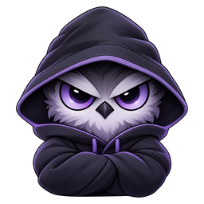
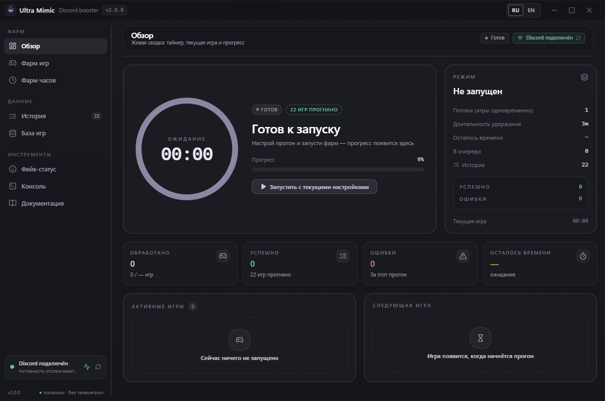
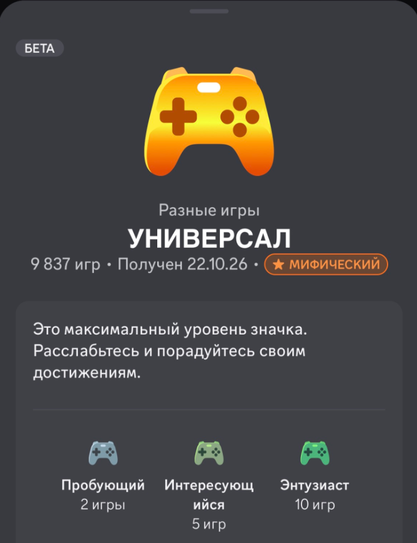

<div align="center">



# Ultra Mimic

**Local Discord game activity emulation.**<br>
Launches games from the Discord database, holds them for the right time and keeps a history — no RPC, no telemetry, no clutter.

<a href="README.md"></a>
<a href="README.en.md"></a>


</div>

---

## About

Ultra Mimic is a portable Windows app that plays Discord game activity: it picks a game from the official Discord database, launches its `.exe` and holds it for as long as needed. Discord shows “Playing …”, while the app keeps a local history and never launches the same game twice.

It works in **process-only** mode: only the process launch is emulated. RPC and console modes were removed to keep behaviour predictable and identical on any machine.

- Portable build — a single `.exe`, nothing to install
- All statistics and history stay on your PC
- Russian and English interface, switched right in the title bar

## Features

| Section | What it does |
| --- | --- |
| **Overview** | Live snapshot: current game timer, progress and the next game. During the built-in pause the ring stays full in amber. |
| **Game farm** | The main mode. Hold, game limit, filters: skip played and 18+. A 20 second pause after every game is built in. |
| **Hour farm** | One selected game held for the chosen duration. Selection on the left, database search on the right. |
| **History** | Every farmed game. Search, return a game to the pool, clear the history. |
| **Game database** | Executable games Discord can detect. Search by name or path, farmed marks, cache refresh. |
| **Fake status** | Shows a selected game or custom text in your Discord status without a full session. |
| **Console** | Technical log: what launched, how long it was held, what failed. |
| **Documentation** | A short explanation of every section inside the app. |

## How it works

1. **Discord sees the process.** Ultra Mimic takes a game from the Discord database and launches its `.exe` the same way a normal launch does.
2. **Hold.** The game stays active for the configured time. The default is 3 minutes — enough for the activity to count.
3. **Switch game.** The process closes, a 20 second pause follows, then the next game starts. Games already farmed are skipped.
4. **History.** Every completed game goes to history right away and is never launched again.

## Quick start

1. Download `Ultra Mimic.exe` — no installation required.
2. Start Discord: it must be running before a session begins.
3. Open **Game farm**, check hold and limit, press **Start** — the app switches to **Overview** right away.
4. Follow progress in **Overview** and see the result in **History**.

A session can be finished at any time with the **Finish** button — the current run stops and history is kept.

### Default settings

| Setting | Value |
| --- | --- |
| Games per session | 100 |
| Hold | 3 minutes (from 15 seconds up to 1 hour, 30 second steps) |
| Pause after a game | 20 seconds |
| Games in Hour farm | 1 |

## Screenshots

The main page — “Overview”: current game timer, progress and queue.



<p align="center">
  <br>
  <sub>The Discord “Universal” badge after a session</sub>
</p>

## Data and privacy

Everything is local, no account is needed and nothing is sent anywhere.

| What | Where |
| --- | --- |
| Settings, history, game database cache | `%APPDATA%\Ultra Mimic` |
| WebView2 profile | the same folder, in `EBWebView` |

WebView2 caches are pruned on exit, so the folder does not grow over time.

## Good to know

> **Do not run Ultra Mimic during a real game.** The app does not bypass anti-cheat: activity emulation, process spoofing and launching a game in parallel can be treated as tampering by anti-cheat — up to an account ban, a hardware block or lost progress. Use the app only outside a game and at your own risk.

- Discord must be running before a session starts.
- One game at a time: Discord counts only one activity, so both Game farm and Hour farm run exactly one game at once.
- History records a completed launch; it does not prove Discord counted the game.
- Adult games can be excluded with a single filter toggle.
- The game list is the official Discord database and can be refreshed from the Game database tab.

## Building from source

You need Windows 10/11 x64, Node.js 20+ and Rust with the MSVC toolchain (Visual Studio Build Tools, C++ workload).

```bat
build.bat
```

The script sets up the Rust toolchain and the MSVC environment, builds the frontend and Rust, then prints the size and SHA256 of the result.

```text
Output: src-tauri\target\release\Ultra Mimic.exe
```

Development mode with hot reload:

```bat
dev.bat
```

> If you changed the app icon, delete `src-tauri\target\release\build\ultra-mimic-*` before building, otherwise Windows keeps the old icon in the `.exe` from the resource cache.

## Project layout

```text
mimic 2.0
├─ build.bat              release build
├─ dev.bat                development mode
├─ src\                   interface: React + TypeScript
├─ src-tauri\             backend: Rust + Tauri 2
│  ├─ src\                commands, spoofer, history, Discord
│  └─ icons\              app icons
├─ public\logo.png        in-app logo
└─ docs\                  README screenshots
```

## Tech stack

| Layer | Used |
| --- | --- |
| Interface | React 18, TypeScript 5, Vite 6, Tailwind CSS 3, Framer Motion |
| Shell | Tauri 2, WebView2 |
| Backend | Rust |
| Icons | Lucide |

## Disclaimer

Ultra Mimic is a local tool. It is not affiliated with Discord, does not modify game clients and needs no account access. Use it responsibly and in line with Discord rules.

The software is provided "as is", without warranty of any kind. The author is not liable for any consequences of using it: suspension, restriction or deletion of Discord accounts, game accounts or other services, data loss, lost profits or any other damages. Activity emulation may violate Discord's rules and the rules of individual games — you accept the decision to use the app and the associated risk.

## License

[GNU GPL v3](LICENSE) © 2026 on1felix

Ultra Mimic is distributed under the GNU General Public License v3.0. The [LICENSE](LICENSE) file adds terms under section 7 of the GPL: they preserve attribution, require marking modified versions and forbid presenting forks as the original project.

Repository: [github.com/on1felix/Ultra-Mimic](https://github.com/on1felix/Ultra-Mimic)

<div align="center">
<sub><a href="README.md">Читать на русском</a></sub>
</div>