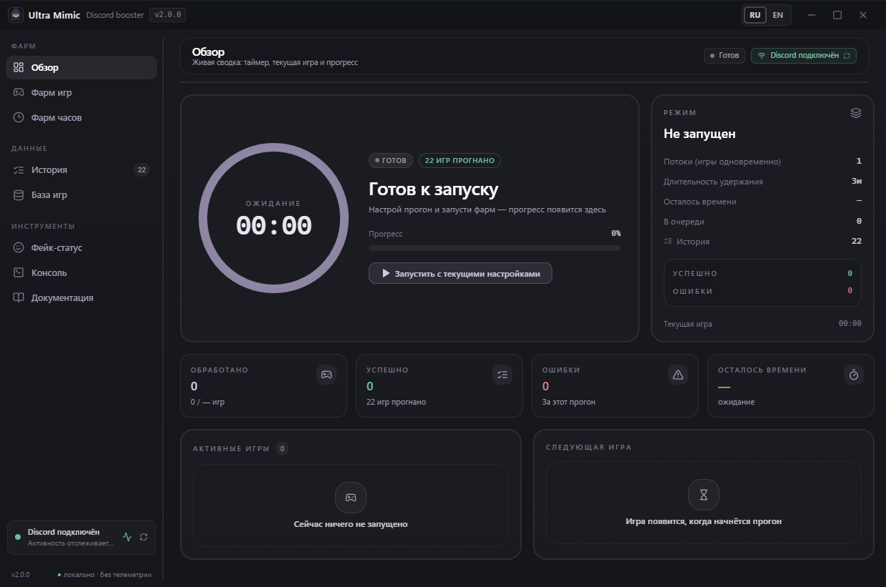
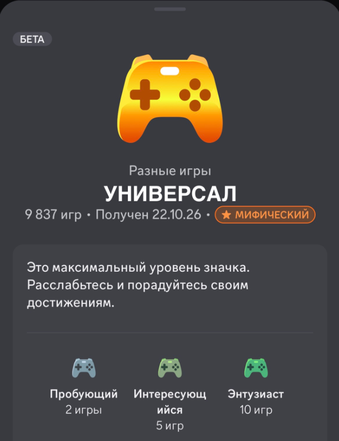

<div align="center">


# Ultra Mimic

**Локальная эмуляция игровой активности Discord.**<br>
Запускает игры из базы Discord, держит их нужное время и ведёт историю — без RPC, телеметрии и лишних настроек.

<a href="README.md"></a>
<a href="README.en.md"></a>


</div>

---

## О приложении

Ultra Mimic — портативное приложение для Windows, которое проигрывает игровую активность в Discord: берёт игру из официальной базы Discord, запускает её `.exe` и удерживает столько времени, сколько нужно. Discord показывает «Играет в …», а приложение ведёт локальную историю и не даёт запускать одну и ту же игру дважды.

Работает в режиме **process-only**: эмулируется только запуск процесса. RPC- и консольные режимы удалены, чтобы поведение было предсказуемым и одинаковым на любой системе.

- Портативная сборка — один `.exe`, установка не нужна
- Вся статистика и история остаются на компьютере
- Интерфейс на русском и английском, переключение в шапке окна

## Возможности

| Раздел | Что делает |
| --- | --- |
| **Обзор** | Живая сводка: таймер текущей игры, прогресс и следующая игра. Во время встроенной паузы кольцо стоит полным и подсвечивается жёлтым. |
| **Фарм игр** | Основной режим. Удержание, лимит игр, фильтры: пропуск прогнанных и 18+. Пауза 20 секунд после каждой игры встроена. |
| **Фарм часов** | Одна выбранная игра на выбранное время. Слева — выбранная игра и длительность, справа — поиск по базе. |
| **История** | Все прогнанные игры. Поиск, возврат игры в пул и очистка истории. |
| **База игр** | Игры с `.exe`, которые видит Discord. Поиск по названию или пути, отметка «фармлено», обновление базы. |
| **Фейк-статус** | Показывает выбранную игру или свой текст в статусе Discord без полноценной сессии. |
| **Консоль** | Технический журнал: что запустилось, сколько держалось, что не сработало. |
| **Документация** | Короткое объяснение каждого раздела прямо в приложении. |

## Как это работает

1. **Discord видит процесс.** Ultra Mimic берёт игру из базы Discord и запускает её `.exe` так же, как это делает обычный запуск.
2. **Удержание.** Игра остаётся активной заданное время. По умолчанию 3 минуты — этого достаточно, чтобы активность засчиталась.
3. **Смена игры.** Процесс закрывается, выдерживается пауза 20 секунд, затем запускается следующая игра. Уже прогнанные игры пропускаются.
4. **История.** Каждая завершённая игра сразу попадает в историю и больше не запускается.

## Быстрый старт

1. Скачайте `Ultra Mimic.exe` — установка не требуется.
2. Запустите Discord: он должен работать до начала сессии.
3. Откройте **«Фарм игр»**, проверьте удержание и лимит, нажмите **«Запустить»** — приложение сразу переключится на **«Обзор»**.
4. Следите за прогрессом в **«Обзоре»**, результат смотрите в **«Истории»**.

Сессию можно завершить в любой момент кнопкой **«Завершить»** — текущий прогон остановится, а история сохранится.

### Настройки по умолчанию

| Параметр | Значение |
| --- | --- |
| Игр за сессию | 100 |
| Удержание | 3 минуты (от 15 секунд до 1 часа, шаг 30 секунд) |
| Пауза после игры | 20 секунд |
| Игр в «Фарме часов» | 1 |

## Скриншоты

Главная страница — «Обзор»: таймер текущей игры, прогресс и очередь.



<p align="center">
  <br>
  <sub>Значок Discord «Универсал» после сессии</sub>
</p>

## Данные и приватность

Всё хранится локально, аккаунт не нужен, статистика никуда не отправляется.

| Что | Где |
| --- | --- |
| Настройки, история, кэш базы игр | `%APPDATA%\Ultra Mimic` |
| Профиль WebView2 | там же, в подпапке `EBWebView` |

Кеши WebView2 подчищаются при выходе, поэтому папка не разрастается.

## Важно знать

> **Не запускайте Ultra Mimic во время настоящей игры.** Приложение не обходит античиты: эмуляцию активности, подмену процесса и запуск игры «рядом» античит может расценить как вмешательство — вплоть до бана аккаунта, блокировки по железу или потери прогресса. Используйте приложение только вне игры и на свой риск.

- Discord должен быть запущен до старта сессии.
- Одна игра за раз: Discord засчитывает только одну активность, поэтому и в «Фарме игр», и в «Фарме часов» одновременно работает ровно одна игра.
- История фиксирует завершённый запуск, но не доказывает, что Discord засчитал игру.
- Игры 18+ можно исключить одним переключателем в фильтрах.
- Список игр — это официальная база Discord, её можно обновить кнопкой в «Базе игр».

## Сборка из исходников

Понадобятся Windows 10/11 x64, Node.js 20+ и Rust с MSVC-тулчейном (Visual Studio Build Tools, компонент C++).

```bat
build.bat
```

Скрипт сам подставит Rust-тулчейн и окружение MSVC, соберёт фронтенд и Rust, затем напечатает размер готового файла и SHA256.

```text
Готовый файл: src-tauri\target\release\Ultra Mimic.exe
```

Режим разработки с горячей перезагрузкой:

```bat
dev.bat
```

> Если меняли иконку приложения, перед сборкой удалите `src-tauri\target\release\build\ultra-mimic-*`, иначе Windows оставит в `.exe` старую иконку из кеша ресурсов.

## Структура проекта

```text
mimic 2.0
├─ build.bat              сборка релиза
├─ dev.bat                режим разработки
├─ src\                   интерфейс: React + TypeScript
├─ src-tauri\             бэкенд: Rust + Tauri 2
│  ├─ src\                команды, спуфер, история, Discord
│  └─ icons\              иконки приложения
├─ public\logo.png        логотип в интерфейсе
└─ docs\                  скриншоты для README
```

## Технологии

| Слой | Что используется |
| --- | --- |
| Интерфейс | React 18, TypeScript 5, Vite 6, Tailwind CSS 3, Framer Motion |
| Оболочка | Tauri 2, WebView2 |
| Бэкенд | Rust |
| Иконки | Lucide |

## Дисклеймер

Ultra Mimic — локальный инструмент. Он не связан с Discord, не изменяет клиент игры и не требует доступа к аккаунту. Используйте его ответственно и с учётом правил Discord.

Программа предоставляется «как есть», без каких-либо гарантий. Автор не несёт ответственности за любые последствия её использования: блокировку, ограничение или удаление аккаунта Discord, аккаунтов игр и других сервисов, потерю данных, упущенную выгоду и иные убытки. Эмуляция активности может нарушать правила Discord и правила отдельных игр — решение использовать приложение и связанный с этим риск вы принимаете на себя.

## Лицензия

[GNU GPL v3](LICENSE) © 2026 on1felix

Проект распространяется по GNU General Public License v3.0. В файле [LICENSE](LICENSE) к тексту лицензии добавлены условия по §7: они сохраняют указание авторства, требуют помечать изменённые версии и запрещают выдавать форки за оригинал.

Репозиторий: [github.com/on1felix/Ultra-Mimic](https://github.com/on1felix/Ultra-Mimic)

<div align="center">
<sub><a href="README.en.md">Read this in English</a></sub>
</div>
